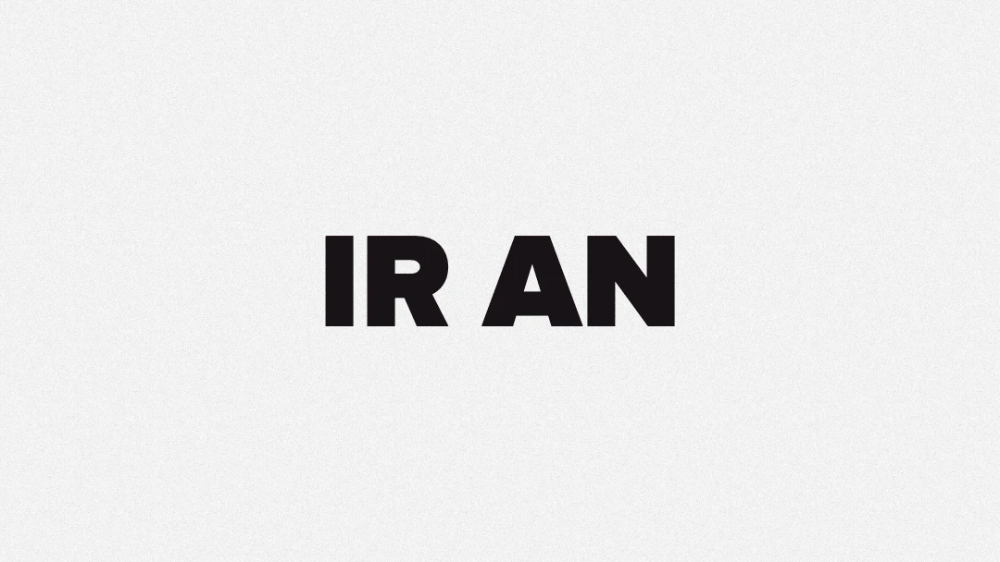
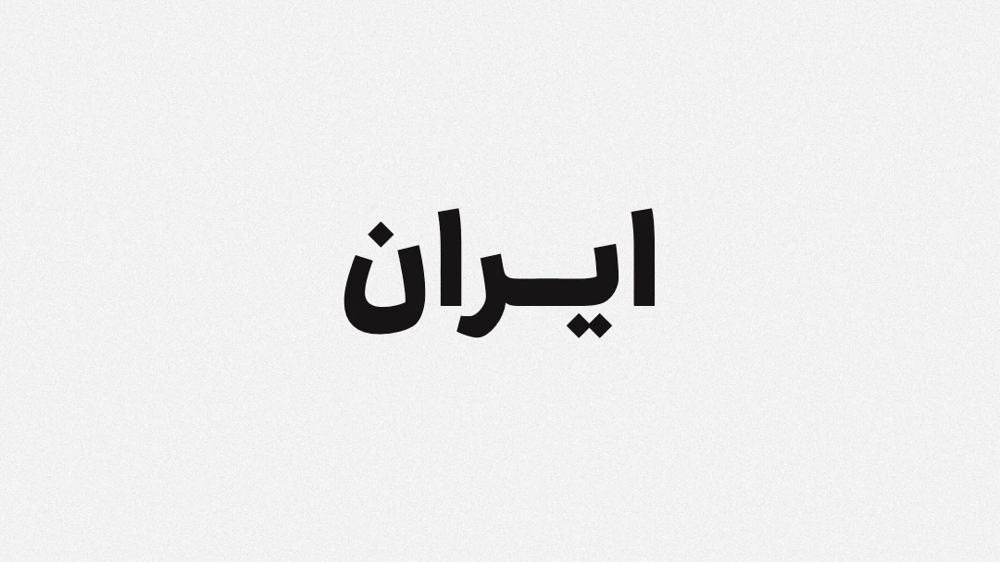

# Word & Capsule Animation · انیمیشن کلمه و کپسول

Type a word, and a rounded capsule opens inside it. Each time the capsule closes and opens again it reveals the next photo. When you like the result, export it as a looping GIF for Instagram, LinkedIn, Stories, X or YouTube.

It works in **English, Persian (فارسی) and Arabic (العربية)**. Text direction, the side of the settings panel, fonts, numbers and every label follow the language you pick.

**Live app:** https://word-capsule-animation.vercel.app

<p align="center">
  
  
</p>

<p align="center"><sub>Frames from the exported GIF, at the moment the capsule is about to open. English uses Proxima Nova (Figtree as a free fallback). Persian and Arabic use Ravi.</sub></p>

---

## Contents

- [Screenshots](#screenshots)
- [What it does](#what-it-does)
- [Every setting, explained](#every-setting-explained)
- [How the animation works](#how-the-animation-works)
- [How the GIF export works](#how-the-gif-export-works)
- [File size guide](#file-size-guide)
- [Mobile layout](#mobile-layout)
- [Languages and fonts](#languages-and-fonts)
- [Privacy and network requests](#privacy-and-network-requests)
- [Run it locally](#run-it-locally)
- [Project structure](#project-structure)
- [Deployment](#deployment)
- [Customising](#customising)
- [Browser support](#browser-support)
- [Credits and licence](#credits-and-licence)

---

## Screenshots

**English** — settings on the left, live preview and timeline on the right:


**Persian** — the whole layout mirrors for right-to-left languages:


---

## What it does

- **Live preview.** Every change shows up immediately on the canvas: word, photos, ratio, font, weight, background and speed.
- **A capsule inside the word.** The word is split in two and a pill-shaped window opens between the halves. It cycles: open wide → hold → close to a circle → close to a thin line → swap photo → open again.
- **Automatic split, or your choice.** By default the capsule opens in the middle of the word. You can pick any other gap between two letters instead.
- **Real kashida for Persian and Arabic.** When the two letters beside the capsule join in script, the word is stretched with a kashida (ـ) under the capsule so the letters stay connected. You choose how long it is.
- **Your own photos.** Upload as many as you like, in any order. They can be removed one by one, and the defaults come back with one tap.
- **Backgrounds.** Grain, white, black, your own image, or **From photo**: soft, blurred colour shapes taken from the photo in the capsule. They slowly drift around the word and fade to the next photo's colours on every swap.
- **Timeline.** Play/pause, scrub, speed from 0.5× to 2×, loop or play once, and a smooth "replay" that closes the capsule before starting over.
- **GIF export.** Up to 2160 px wide at up to 50 fps. You can cancel at any point, the GIF downloads automatically, and a preview of it appears in the panel.
- **No account, no upload.** Everything, including the GIF encoder, runs in your browser.

---

## Every setting, explained

| Setting | Options | Default | Notes |
|---|---|---|---|
| **Type your word** | Up to 24 characters | `IRAN` / `ایران` | Required. Changing the word resets *Capsule position* to automatic. |
| **Capsule position** | Automatic, or "after letter n" for every gap in the word | Automatic | Each choice is shown as the word split by a dot, e.g. `IR ● AN`, `ای ● ران`. |
| **Text length** (kashida) | Short, Medium, Long, Extra long | Medium | Persian and Arabic only. Sets how many kashida characters sit on each side of the capsule. Hidden in English. |
| **Aspect ratio** | 1:1 Square · 4:5 Instagram & LinkedIn post · 9:16 Reels & Stories · 16:9 X & YouTube | 1:1 | The GIF is exported in the same ratio. |
| **Photos** | Default photos · My photos | Default photos | Selecting *My photos* shows the upload button. With more than five photos, four thumbnails are shown plus a "+N" tile that expands the rest. |
| **Font** | Upload a `.ttf`, `.otf`, `.woff` or `.woff2` | Ravi (fa/ar), Proxima Nova or Figtree (en) | An uploaded font replaces the default for every language. |
| **Font weight** | Light · Regular · Medium · Bold · Black | Black | Applies to the word in the preview and the GIF. |
| **Background** | Noise · From photo · White · Black · Custom | Noise | *Custom* asks for an image. Light or dark text is picked automatically from its brightness. |
| **Animation speed** | 0.5× – 2× in 0.25 steps | 1× | Also available as a chip on the timeline. Applies to the GIF. |
| **Playback mode** | Loop · Play once, plus *Replay* | Loop | *Play once* stops on the last photo. |
| **GIF size** | Small 480 · Medium 720 · Large 1080 · Extra large 2160 (4K) | Large 1080 | The width in pixels. The height follows the aspect ratio. |
| **Frames per second** | 25 · 30 · 50 | 50 | More frames means smoother motion and a bigger file. |
| **Photos in GIF** | 3 · 5 · All | All | Each option shows how long the GIF will be, e.g. "All photos (9) — about 40 s". The numbers follow the speed setting. |

Under these settings, a live line estimates the file size, e.g. *Estimated file size: about 26 MB*. It turns amber with a hint when the estimate passes 15 MB, a common limit on social media. After export, the real size is shown in the status line. **Reset to default** restores every setting except the language.

---

## How the animation works

One cycle per photo lasts about **4.35 s** at 1× speed:

| Step | Duration | Capsule width (× font size) | Easing |
|---|---|---|---|
| Open | 0.78 s | circle 0.9 → open 2.4 | spring with ~3% overshoot |
| Hold | 2.05 s | 2.4 | — |
| Close to circle | 0.52 s | 2.4 → 0.9 | critically damped |
| Pause | 0.06 s | 0.9 | — |
| Close to line | 0.36 s | 0.9 → 0.1 | critically damped |
| Swap photo | 0.08 s | 0.1 | — |
| Open to circle | 0.46 s | 0.1 → 0.9 | spring |
| Pause | 0.04 s | 0.9 | — |

A short intro of 0.94 s comes first: the line grows to full height, then pops to a circle. Each new photo eases in from a 20% zoom and settles at 1:1, so it never looks static.

The word is measured with the canvas text API and shrunk to fit 90% of the frame width. Persian and Arabic are vertically centred on the letter body, and Latin on cap height, so the capsule sits exactly in the middle of the letters in every script.

---

## How the GIF export works

The exporter draws every frame on an off-screen canvas, then quantises and encodes it with [gifenc](https://github.com/mattdesl/gifenc). Several details keep the result smooth and the file small:

1. **One stable palette per photo.** Each photo gets a 255-colour palette, built from a frame where that photo is fully open. Reusing it for every frame of that photo stops colours from flickering between frames.
2. **Delta frames.** When a frame shares the previous frame's palette, only the pixels that changed are written; everything else is transparent and keeps what is already on screen.
3. **Exact timing.** Frame delays are rounded per frame against a running total, so a 50 fps GIF keeps its real length instead of drifting.
4. **"From photo" background extras:**
   - while the colours fade between two photos, those frames get their own palette, so the fade never posterises;
   - a fixed 4×4 ordered dither breaks gradient banding into a fine, steady pattern that does not shimmer;
   - pixels whose colour moved only a hair are left as they were, which roughly halves the file with no visible change;
   - the drifting shapes complete whole turns over the length of the GIF, so the loop has no jump.
5. **Seamless loop.** The GIF only plays the photos you chose, and its last frames lead back into the first photo.
6. **Cancel any time.** Click the button again while it says *Creating… 42% · Cancel*. A red message and a short notification confirm the cancel.

When the GIF is ready it downloads automatically, using a name built from the word and the ratio, e.g. `IRAN-1x1.gif`. It also appears in the **Preview** box. If the browser blocks the download, you can right-click the preview to save it. After a visitor's first GIF, a one-time card invites them to star the project on GitHub.

---

## File size guide

These are real exports from this app with the default photos and the Noise background, measured on an Apple Silicon Mac:

| Size | FPS | Photos | Ratio | Time to create | File size |
|---|---|---|---|---|---|
| 480 | 25 | 3 | 4:5 | a few seconds | 1.6 MB |
| 1080 (default) | 50 | all 9 | 1:1 | 44 s | 26 MB |
| 2160 (4K) | 50 | all 9 | 1:1 | 2 min 38 s | 84 MB |

The *From photo* background makes files several times larger, because the whole background moves. Phones take noticeably longer than desktops. To get a small file for social media, lower the size first, then the number of photos, then the frame rate.

---

## Mobile layout

Below 860 px wide the layout changes for phones:

- The preview stays fixed at the top, at 90% of the screen width with rounded corners. Very tall ratios (9:16) are capped so the settings stay reachable.
- The settings live in a **bottom sheet** with rounded corners and a grab line. The sheet:
  - **rises halfway on its own** as soon as you scroll, tap or type in it;
  - can be **dragged** to three stops (resting, half, full), and a tap on the grab line toggles it;
  - **goes back down** when you tap anywhere outside it, or pull down on the settings once they are scrolled to the top.
- *Create & download GIF* and *Reset* stay pinned at the bottom of the screen.

---

## Languages and fonts

| | English | Persian | Arabic |
|---|---|---|---|
| Direction | left-to-right | right-to-left | right-to-left |
| Interface font | Proxima Nova → Figtree | Ravi → Vazirmatn | Ravi → Vazirmatn |
| Font for the word | Proxima Nova → Figtree (Black) | Ravi (Light – Black) | Ravi (Light – Black) |
| Digits | 0–9 | ۰–۹ | ٠–٩ |
| Help icon | ? | ؟ | ؟ |

- The site **always opens in English**. The flag button in the header switches language, and each language is listed in the current language with its native name beside it.
- **Ravi** is a commercial typeface, used here under a web licence. Its files are **not** in this repository. They are served from a separate deployment at `https://word-capsule-fonts.vercel.app`, and the `@font-face` rules at the top of `src/styles.css` point there.
- **Proxima Nova** is used when it is installed on the visitor's device. Everyone else gets **Figtree**, a free, similar typeface from Google Fonts.
- **Vazirmatn** (free, Google Fonts) is the last fallback for Persian and Arabic.

---

## Privacy and network requests

Photos, fonts you upload and exported GIFs never leave your device. The page makes only these requests:

| Request | Why |
|---|---|
| `fonts.googleapis.com`, `fonts.gstatic.com` | Figtree and Vazirmatn |
| `word-capsule-fonts.vercel.app` | the Ravi font files |
| `api.github.com/repos/Hamzeh75/word-capsule-animation` | the star count in the footer (once per visit) |

Storage: `localStorage` keeps one flag so the GitHub star card is shown only once, and `sessionStorage` caches the star count for the visit. There are no cookies, no analytics and no tracking.

---

## Run it locally

Requirements: **Node.js 20.19+ or 22.12+**.

```bash
npm install
npm run dev        # http://localhost:5173
```

Production build and local preview:

```bash
npm run build      # outputs to dist/
npm run preview    # serves dist/ at http://localhost:4173
```

> Open the app through the dev or preview server, not by double-clicking `index.html`. Browsers block reading image pixels from `file://`, so GIF export only works when the page is served over HTTP.

---

## Project structure

```
├── index.html            # page markup: settings panel, stage, star card
├── src/
│   ├── main.js           # state, timeline, renderer, controls, mobile sheet, GIF export
│   ├── i18n.js           # every interface string for en / fa / ar
│   └── styles.css        # all styles: desktop, mobile sheet, RTL/LTR, @font-face
├── public/
│   ├── img/1.jpg … 9.jpg # default photos, in play order
│   ├── img/grain.jpg     # noise background texture
│   └── favicon.svg
├── docs/                 # images used in this README
├── vite.config.js
├── vercel.json           # build settings and cache headers
└── package.json
```

The only runtime dependency is `gifenc`. Everything else is vanilla HTML, CSS and JavaScript (ES modules), bundled by [Vite](https://vite.dev). There is no backend; the build output is a static site.

---

## Deployment

The site is hosted on **Vercel** and connected to this repository: **every push to `main` deploys to production** within a few seconds. `vercel.json` sets the build command (`npm run build`), the output folder (`dist`), long-term caching for hashed assets and one-week caching for images.

To deploy your own copy, import the repository at [vercel.com/new](https://vercel.com/new). Vercel detects Vite automatically. Or use the CLI:

```bash
npm i -g vercel
vercel --prod
```

The Ravi fonts are a separate Vercel project that is **not** connected to Git. It is deployed by hand from a local, git-ignored `word-capsule-fonts/` folder. That folder holds the `.woff2` files and a `vercel.json` that adds CORS and cache headers. A fork without access to it simply falls back to Vazirmatn.

---

## Customising

**Default photos.** Replace `public/img/1.jpg` … `9.jpg`. To add or remove photos, or to change the framing, edit `DEFAULTS` in `src/main.js`:

```js
{ src: IMG + '1.jpg', pos: [.6, .45] },   // pos = [x, y] from 0 to 1: where the subject's centre is
```

Wide images (around 2.7:1) fill the open capsule with the least cropping. Around 1800 px wide is plenty.

**Text.** Every label, tooltip, option and message is in `src/i18n.js`, one block per language.

**Timing.** The animation steps are the `CYCLE` table in `src/main.js`, as `[name, seconds, fromWidth, toWidth, easing]`.

**Fonts.** Change the `@font-face` rules at the top of `src/styles.css`, and `S.family` / `LATIN_FAMILY` in `src/main.js`.

---

## Browser support

Current versions of Chrome, Edge, Safari and Firefox, on desktop and mobile. GIF export runs on the main thread with the Canvas API. Large exports (2160 px, all photos, 50 fps) need plenty of memory and can take several minutes on phones.

---

## Credits and licence

- Built with [Claude](https://claude.ai) by [Hamzeh75](https://github.com/Hamzeh75).
- GIF encoding: [gifenc](https://github.com/mattdesl/gifenc) by Matt DesLauriers (MIT).
- Fonts: Ravi (commercial, web licence; not distributed here), Figtree and Vazirmatn (SIL Open Font License), Proxima Nova (commercial; only used when installed locally).
- The default photos belong to the author. Check their usage rights before reusing them.

If you find it useful, a ⭐ on [GitHub](https://github.com/Hamzeh75/word-capsule-animation) is appreciated.
