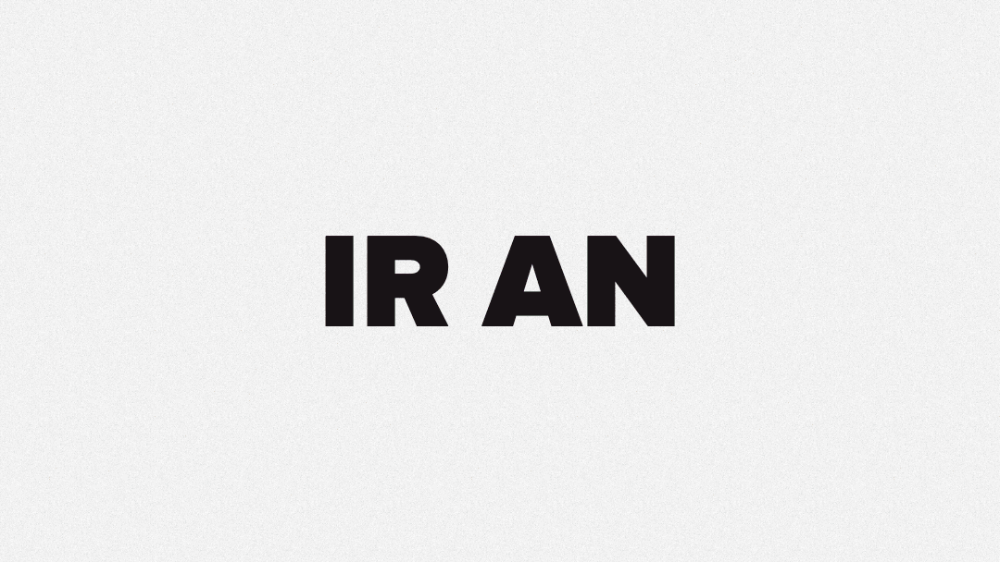
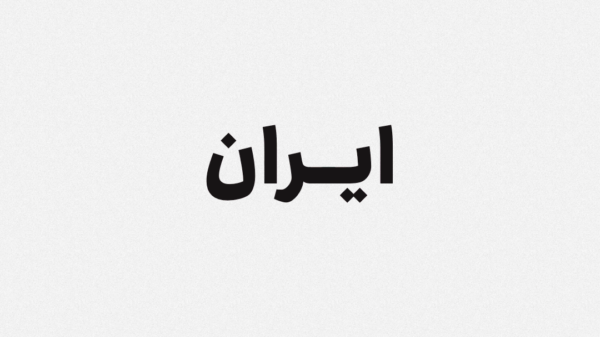
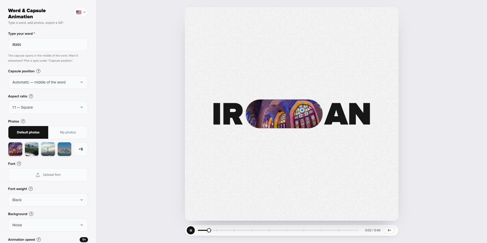
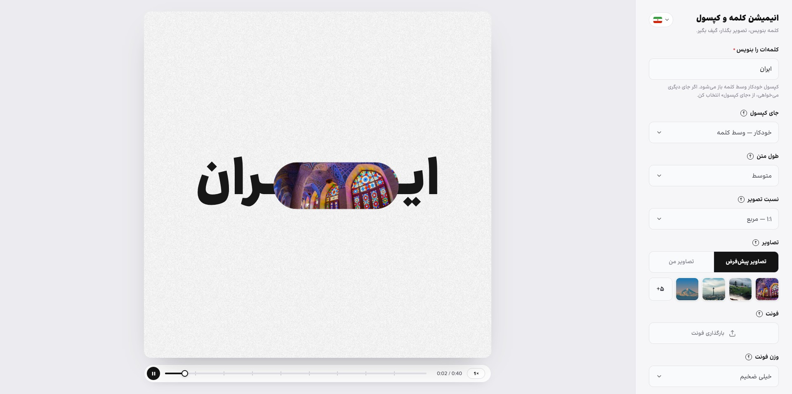

# Word & Capsule Animation · انیمیشن کلمه و کپسول

Type a word, add photos, and download a looping GIF where a capsule opens inside the word.

**Try it:** https://word-capsule-animation.vercel.app

<p align="center">
  
  
</p>





## Features

- English, Persian, Arabic, Chinese and Hindi, with right-to-left layout for Persian and Arabic
- Use the default photos or upload your own
- Choose where the capsule opens, the font weight, the aspect ratio and the background
- Export GIFs up to 4K at 50 fps
- Runs entirely in your browser. Nothing is uploaded.

## Run locally

```bash
npm install
npm run dev
```

Built with [Vite](https://vite.dev) and [gifenc](https://github.com/mattdesl/gifenc).

## Credits

Made with [Claude](https://claude.ai) by [HamzehGhoreyshi](https://github.com/HamzehGhoreyshi). Website: [hamzeh.framer.ai](https://hamzeh.framer.ai). If you like it, a ⭐ is appreciated.
