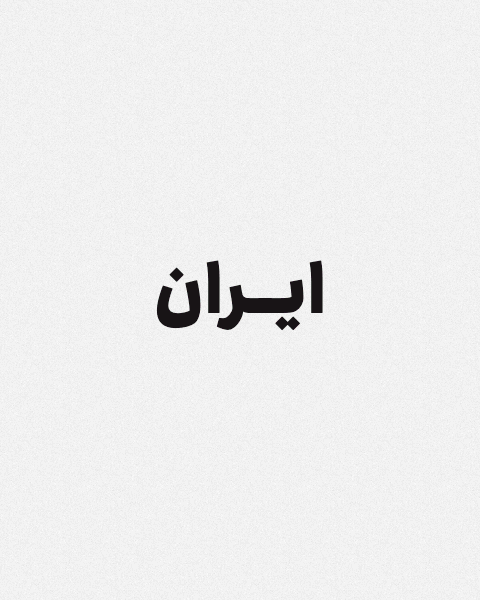
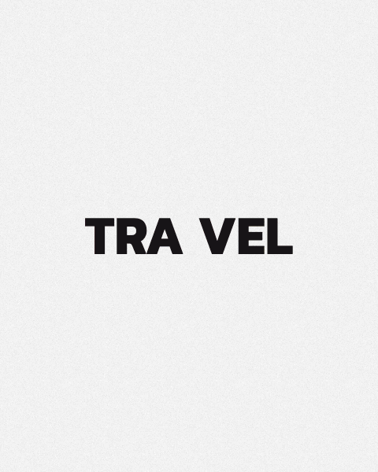
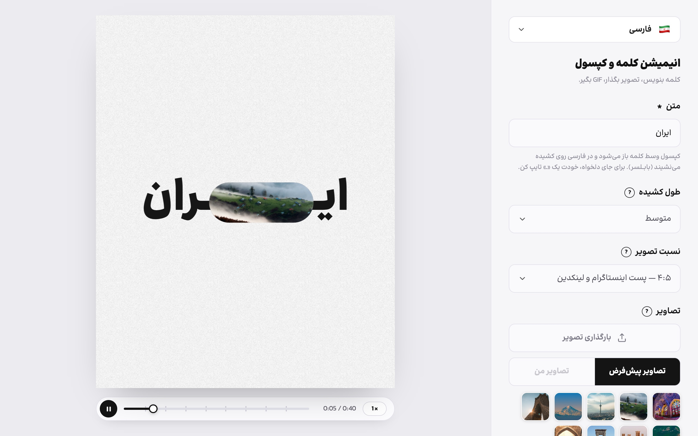
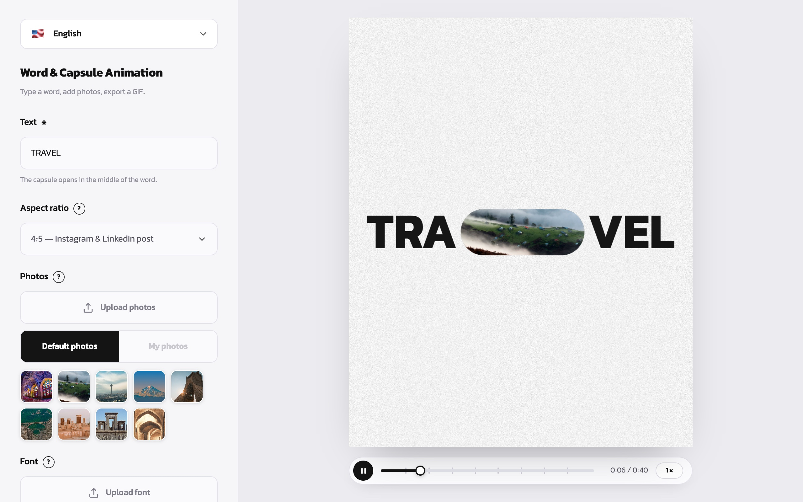

# Word & Capsule Animation · انیمیشن کلمه و کپسول

A browser-based typography animation tool. Type a word, and a capsule opens in the middle of it, revealing a new photo each time it closes and reopens. Export the result as a smooth, looping GIF.

Supports **Persian, English and Arabic**: the full UI, text direction and panel side all switch with the language.

**Live demo:** https://word-capsule-animation.vercel.app

## Examples

GIFs exported straight from the app (480 px, 25 fps, 3 photos, 4:5):

<p align="center">
  
  &nbsp;&nbsp;
  
</p>

## Screenshots





## Features

- Automatic kashida (letter stretch) placement for Persian and Arabic. Type `ـ` to choose the spot yourself.
- Aspect ratios: 4:5, 9:16, 1:1, 16:9
- Upload your own photos (removable), font and background image
- Timeline with play/pause and scrubbing, speed control from 0.5× to 2×, loop / play once, and a smooth replay
- GIF export at up to 50 fps, using one stable palette per photo and delta frames to keep files small
- Responsive layout with a sticky preview on mobile
- Runs entirely in the browser. Nothing is uploaded to a server.

## Tech stack

| | |
|---|---|
| Build tool | [Vite](https://vite.dev) |
| UI | Vanilla HTML / CSS / JavaScript (ES modules) |
| Rendering | Canvas 2D with a custom spring-based timeline |
| GIF encoding | [gifenc](https://github.com/mattdesl/gifenc) (MIT) |
| Fonts | Ravi (licensed, served from a separate fonts deployment) for Persian and Arabic; Proxima Nova if installed, otherwise Figtree (Google Fonts), for English; Vazirmatn as a fallback |

There is no backend. The build output is a static site.

## Project structure

```
├── index.html          # page markup (settings panel + stage)
├── src/
│   ├── main.js         # app logic: state, timeline, renderer, controls, GIF export
│   ├── i18n.js         # UI strings for fa / en / ar
│   └── styles.css      # all styles, including mobile and RTL/LTR
├── public/
│   ├── img/1.jpg … 9.jpg   # default photos, in play order
│   ├── img/grain.jpg       # noise background texture
│   └── favicon.svg
├── vite.config.js
├── vercel.json
└── package.json
```

## Run locally

Requirements: **Node.js 20.19+ or 22.12+** (see `.nvmrc`).

```bash
npm install
npm run dev        # http://localhost:5173
```

Production build:

```bash
npm run build      # outputs to dist/
npm run preview    # serves dist/ at http://localhost:4173
```

> Open the app through the dev or preview server, not by double-clicking `index.html`. Browsers block reading image pixels from `file://`, so GIF export only works when the page is served.

## Deploy to Vercel

### Option A: via GitHub (recommended)

```bash
git init
git add .
git commit -m "Initial commit"
git branch -M main
git remote add origin https://github.com/<your-username>/word-capsule-animation.git
git push -u origin main
```

Then on [vercel.com/new](https://vercel.com/new), import the repository. Vercel detects Vite automatically; `vercel.json` already sets the build command (`npm run build`) and output directory (`dist`). Click **Deploy**. Every push to `main` redeploys.

### Option B: Vercel CLI

```bash
npm i -g vercel
vercel          # preview deployment
vercel --prod   # production deployment
```

`vercel.json` also sets long-term caching for hashed build assets and one-week caching for images.

## Customising

**Default photos.** Replace `public/img/1.jpg` … `9.jpg`. To add or remove photos, or to adjust the framing, edit `DEFAULTS` in `src/main.js`:

```js
{ src: IMG + '1.jpg', pos: [.6, .45] },   // pos = [x, y] from 0 to 1: the subject's centre
```

Wide images (around 2.7:1) fill the capsule with the least cropping. Keep them around 1800 px wide.

**Fonts.** Ravi is licensed for web use but its files are **not** in this repository. They are served from a separate Vercel project, `https://word-capsule-fonts.vercel.app`, which is deployed by hand from a local `word-capsule-fonts/` folder (ignored by git). The `@font-face` rules at the top of `src/styles.css` point there. Without access to that project the app falls back to Vazirmatn.

**Translations.** All UI text lives in `src/i18n.js`.

## Browser support

Current Chrome, Edge, Safari and Firefox on desktop and mobile. GIF export uses the Canvas API and runs on the main thread, so large exports (1080 px, all photos, 50 fps) can take a while on slower phones.

## License

Your project code. Bundled dependency: gifenc (MIT). The default photos are yours. Check their usage rights before publishing.
